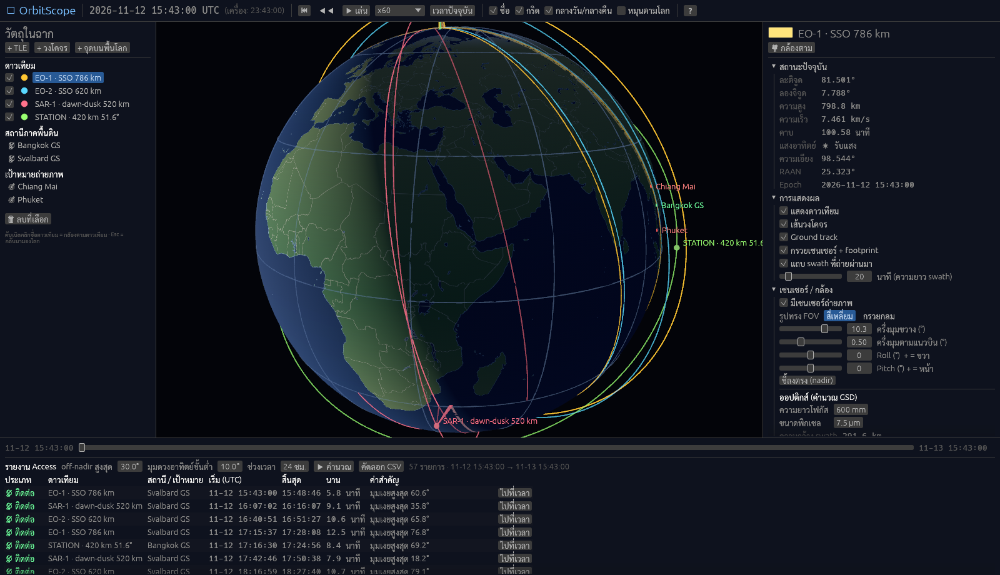
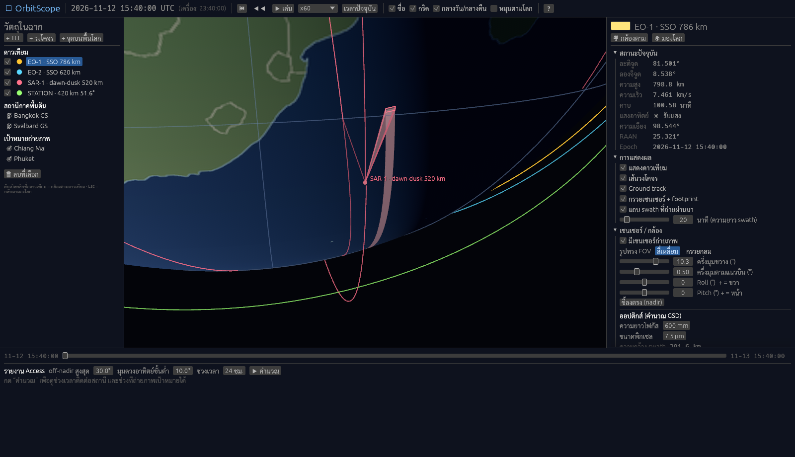

# OrbitScope

โปรแกรมจำลองวงโคจรดาวเทียมและการถ่ายภาพแบบ 3D สไตล์ STK เขียนด้วย Rust (Bevy + egui) รองรับ **macOS และ Windows**





## ทำอะไรได้ตอนนี้ (MVP)

- โลก 3D ทรงรี WGS84 หมุนตามเวลาจริง (GMST) พร้อมแสงกลางวัน/กลางคืนตามตำแหน่งดวงอาทิตย์
- ดาวเทียมจาก **TLE** (วางได้หลายดวง) หรือจาก **ค่าวงโคจร** (มีตัวช่วยคำนวณ sun-synchronous + เวลาผ่านเส้นศูนย์สูตร)
- เส้นวงโคจร, ground track (ย้อนหลัง/ล่วงหน้า 1 รอบ), เส้น nadir
- **เซนเซอร์ถ่ายภาพ**: FOV สี่เหลี่ยม/กรวย, roll/pitch, กรวยโปร่งแสง, footprint บนพื้น, แถบ **swath** ที่กวาดผ่านมา
- คำนวณ **ความกว้าง swath**, จุดเล็ง, off-nadir, **GSD** จากความยาวโฟกัส/ขนาดพิกเซล, มุมแสงอาทิตย์ที่จุดเล็ง
- สถานีภาคพื้นดิน (เส้นติดต่อเมื่อมองเห็น, ตาราง Az/El) และเป้าหมายถ่ายภาพ
- **รายงาน Access**: ช่วงติดต่อสถานี (มุมเงยสูงสุด) + ช่วงที่ถ่ายเป้าหมายได้ (จำกัด off-nadir และมุมแสงอาทิตย์) กด “ไปที่เวลา” ได้ และคัดลอกเป็น CSV
- ควบคุมเวลา: เล่น/หยุด/ย้อนหลัง, ความเร็ว x1–x3600, แถบเลื่อนเวลา
- กล้องหมุนรอบโลก/ตามดาวเทียม, โหมดหมุนตามโลก
- UI ภาษาไทย (ฟอนต์ Sarabun ฝังในโปรแกรม) ไฟล์ภาพและฟอนต์ฝังอยู่ใน binary ไฟล์เดียว

> ดาวเทียมตัวอย่าง (EO-1, EO-2, SAR-1, STATION) สร้างจากค่าวงโคจร ณ เวลาที่เปิดโปรแกรม **ไม่ใช่ดาวเทียมจริง** ใช้ปุ่ม **+ TLE** เพื่อใส่ดาวเทียมจริงจาก [CelesTrak](https://celestrak.org/NORAD/elements/)

## วิธีรัน

### 1. ติดตั้ง Rust
- **macOS**: `xcode-select --install` แล้วติดตั้ง Rust จาก <https://rustup.rs>
- **Windows**: ติดตั้ง [Visual Studio Build Tools](https://visualstudio.microsoft.com/visual-cpp-build-tools/) (เลือก “Desktop development with C++”) แล้วติดตั้ง Rust จาก <https://rustup.rs>

### 2. Build และรัน
```bash
cargo run --release -p orbitscope
```
ครั้งแรกจะ compile Bevy นานหน่อย (ประมาณ 3–10 นาทีตามเครื่อง) ครั้งต่อไปจะเร็วขึ้นมาก

ระหว่างพัฒนาใช้ `cargo run -p orbitscope` ก็ได้ (โปรไฟล์ dev ตั้งให้ optimize dependency ไว้แล้ว)

### 3. ทดสอบส่วนคำนวณ
```bash
cargo test -p orbitscope-core
```

### ถ่ายภาพหน้าจออัตโนมัติ (ไม่เปิดหน้าต่าง)
```bash
ORBITSCOPE_SCREENSHOT=shot.png cargo run -p orbitscope
# ตัวเลือกเสริม: ORBITSCOPE_LOOKAT=13.7,100.5  ORBITSCOPE_DIST=17000  ORBITSCOPE_FOCUS=0  ORBITSCOPE_REPORT=1
```
บน Linux ที่ไม่มีไดรเวอร์ Vulkan ให้เพิ่ม `--features gles` และตั้ง `WGPU_BACKEND=gl EGL_PLATFORM=surfaceless`

### Build ไฟล์แจกจ่าย (ไม่ต้องมีเครื่อง Mac/Windows ครบ)
push โปรเจกต์ขึ้น GitHub แล้วไปที่แท็บ **Actions → build → Run workflow** จะได้
- `OrbitScope-windows-x64.zip` (มี `OrbitScope.exe`)
- `OrbitScope-macos-universal.zip` (มี `OrbitScope.app` รันได้ทั้ง Apple Silicon และ Intel)

ถ้า push tag เช่น `v0.1.0` จะสร้าง GitHub Release ให้อัตโนมัติ

> macOS: แอปยังไม่ได้ sign ด้วย Apple Developer ID ครั้งแรกให้คลิกขวา → Open (หรือ System Settings → Privacy & Security → Open Anyway)
> Windows: SmartScreen อาจเตือน ให้กด More info → Run anyway

## การใช้งาน

| การกระทำ | ผล |
|---|---|
| ลากเมาส์ | หมุนกล้อง |
| ล้อเมาส์ | ซูม |
| ดับเบิลคลิกชื่อดาวเทียม / ปุ่ม 🎥 | กล้องตามดาวเทียม |
| Esc | กลับมามองโลก |
| แผงซ้าย | รายการวัตถุ, เพิ่ม TLE / วงโคจร / จุดบนพื้น |
| แผงขวา | คุณสมบัติ, ค่าเซนเซอร์, ค่าที่คำนวณได้ |
| แผงล่าง | แถบเวลา + รายงาน Access |

## โครงสร้างโค้ด

```
crates/
  core/   คำนวณล้วน ไม่มี UI (ทดสอบได้, เอาไปทำ CLI / Python / WASM ต่อได้)
    time.rs     Julian date, GMST
    frames.rs   TEME ↔ ECEF, WGS84 geodetic, az/el, ray–ellipsoid
    orbit.rs    SGP4 (TLE + Keplerian), sun-synchronous helpers
    sensor.rs   FOV, roll/pitch, footprint, swath, GSD
    sun.rs      ตำแหน่งดวงอาทิตย์, มุมแสง, เงาโลก
    access.rs   หาช่วงเวลา (bisection), pass สถานี, โอกาสถ่ายภาพ
  app/    Bevy + egui
    scene.rs    โลก, กล้อง, ดาวเทียม, gizmo เส้น, mesh กรวย/swath
    ui.rs       แผงควบคุม, dialog, รายงาน, ป้ายชื่อ
    scenario.rs สถานะฉาก + ฉากตัวอย่าง
assets/   earth.png (สร้างจาก Natural Earth), ฟอนต์ Sarabun
```

**หน่วยและกรอบอ้างอิง**: ฉาก 3D อยู่ในกรอบ TEME (ผลลัพธ์ของ SGP4) หน่วย km; core ใช้แกน Z ขึ้น ส่วน Bevy ใช้แกน Y ขึ้น (`to_bevy()` แปลงให้)

**ความแม่นยำ**: SGP4 + TEME→ECEF ด้วย GMST (ไม่รวม polar motion ~10 m) และใช้ UTC แทน UT1 (ต่างกัน < 1 วินาที) เพียงพอสำหรับ visualization และวางแผนถ่ายภาพระดับกิโลเมตร

## แผนต่อไป

1. บันทึก/เปิดไฟล์ฉาก (serde + RON/JSON) และเปิดไฟล์ TLE จากดิสก์
2. ดึง TLE จาก CelesTrak ในโปรแกรม (ตาม NORAD ID / กลุ่ม)
3. Coverage grid + revisit time และหลายดาวเทียม (constellation / Walker)
4. มุมมองจากกล้องดาวเทียม (render ภาพจำลองที่กล้องเห็น) + ภาพพื้นโลกความละเอียดสูงแบบ tile
5. Numerical propagator (J2/drag) ผ่าน ANISE/hifitime เมื่อต้องการความแม่นยำสูง
6. Floating origin (`big_space`) สำหรับซูมใกล้ระดับเมตร

## ข้อมูลและไลเซนส์ของบุคคลที่สาม

- ภาพพื้นโลก: สร้างจาก [Natural Earth](https://www.naturalearthdata.com/) (public domain) ด้วยสคริปต์ `tools/earth_tex.py`
- ฟอนต์ Sarabun: SIL Open Font License 1.1 (`assets/OFL-Sarabun.txt`)
- ไลบรารี Rust: Bevy, egui, bevy_egui (MIT/Apache-2.0), sgp4 (MIT), chrono (MIT/Apache-2.0)

ตัวโปรเจกต์เองยังไม่ได้กำหนดไลเซนส์ — เลือกเองได้ตามรูปแบบที่จะใช้งาน (เปิดซอร์สหรือขายเชิงพาณิชย์)
